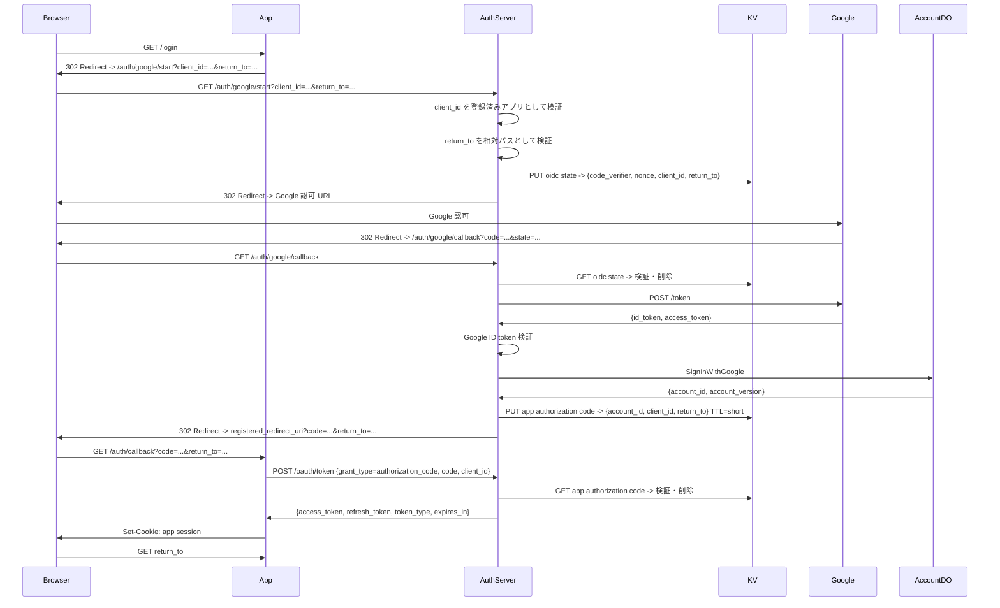

# docs/design.md の仕様変更: 複数アプリ向け authorization code exchange 方式

## 背景

この auth-server は単一アプリ専用ではなく、現在および将来の複数アプリケーションから利用される認証基盤として扱う。

各アプリケーションは同一ドメイン配下に限定しない。サブドメイン分離だけでなく、完全に異なるドメインのアプリケーションも対象にする。

そのため、auth-server が callback 時に発行する `__Host-session` Cookie を各アプリケーションのログインセッションとして使う設計は主経路にしない。`__Host-session` は auth-server 自身の中央認証セッションとして残すが、各アプリケーション向けには短命 authorization code を返し、アプリケーション側 backend が token に交換する方式を主経路にする。

## 方針

- auth-server の `__Host-session` Cookie は残す
- `__Host-session` は auth-server ドメイン上の中央認証セッションとして扱う
- 各アプリケーションのログインセッションは、各アプリケーション自身が自ドメインで発行する
- auth-server から各アプリケーションへは短命 authorization code を渡す
- 各アプリケーション backend は authorization code を auth-server の token endpoint で交換する
- access token に加えて refresh token まで実装する
- revoke、device 管理、session 管理は今回の範囲に含めない

## 新しい認証フロー



## アプリケーション登録

既存の `audience` は JWT の `aud` を表す識別子として使われている。複数アプリの redirect 先や token exchange を安全に扱うには、`audience` だけではなく `client_id` または `app_id` 相当の概念を追加する。

アプリケーション設定は最低限、次を持つ。

```json
{
  "client_id": "cook-note-web",
  "client_secret": "replace-with-secret",
  "token_audience": "cook-note",
  "redirect_uri": "https://cook-note.example.com/auth/callback"
}
```

- `client_id`: 認証フローを開始したアプリケーションの識別子
- `client_secret`: token endpoint でアプリ backend を認証するための secret。ブラウザには渡さない
- `token_audience`: 発行する access token の `aud`
- `redirect_uri`: authorization code を返す先。リクエスト値を自由に採用せず、登録済み値を使う

将来的に 1 client に複数 redirect URI が必要になった場合は `allowed_redirect_uris` に拡張する。ただし初期実装では 1 client 1 redirect URI でよい。

## return_to の扱い

`return_to` は引き続き相対パスのみを許可する。

- `/` で始まること
- `//` で始まらないこと
- `\` を含まないこと
- URL decode 後も同じ条件を満たすこと
- 絶対 URL は受け付けない

callback 後の redirect 先 origin は `return_to` から決めない。`client_id` に登録された `redirect_uri` を使う。

例:

```text
client_id=cook-note-web
return_to=/dashboard

registered redirect_uri:
https://cook-note.example.com/auth/callback

callback redirect:
https://cook-note.example.com/auth/callback?code=...&return_to=%2Fdashboard
```

## authorization code

Google OAuth の code とは別に、auth-server が各アプリケーションへ返す app authorization code を発行する。

app authorization code は以下の性質を持つ。

- CSPRNG で生成する
- one-time use
- 短 TTL
- `client_id` に bind する
- `account_id` に bind する
- `return_to` を保存する
- token exchange 成功時に削除する
- 存在しない、期限切れ、使用済み、不一致の場合は `invalid_grant`

KV の例:

```json
{
  "account_id": "01JGVQ...",
  "account_version": 1,
  "client_id": "cook-note-web",
  "token_audience": "cook-note",
  "return_to": "/dashboard",
  "expires_at": 1745000000
}
```

TTL は 60 秒から 300 秒程度を想定する。

## token endpoint

新しく `POST /oauth/token` を追加する。

authorization code exchange:

```http
POST /oauth/token
Content-Type: application/json
Authorization: Basic base64(client_id:client_secret)

{
  "grant_type": "authorization_code",
  "code": "..."
}
```

レスポンス:

```json
{
  "access_token": "...",
  "refresh_token": "...",
  "token_type": "Bearer",
  "expires_in": 3600
}
```

refresh token exchange:

```http
POST /oauth/token
Content-Type: application/json
Authorization: Basic base64(client_id:client_secret)

{
  "grant_type": "refresh_token",
  "refresh_token": "..."
}
```

レスポンス:

```json
{
  "access_token": "...",
  "refresh_token": "...",
  "token_type": "Bearer",
  "expires_in": 3600
}
```

refresh token はローテーションする。refresh token grant が成功したら、新しい refresh token を発行し、古い refresh token は再利用できない状態にする。

## access token

access token は現在のセッション JWT と同様に RS256 JWT とする。

主な claim:

```json
{
  "iss": "https://auth.example.com",
  "sub": "01JGVQ...",
  "aud": "cook-note",
  "iat": 1745000000,
  "exp": 1745003600,
  "jti": "01JGVS...",
  "account_version": 1
}
```

- `aud` は `client_id` に紐づく `token_audience`
- 各アプリケーション API は `iss`、`aud`、`exp`、署名を検証する
- access token の TTL は既存の `SESSION_TTL_SECS` を流用してよい

## refresh token

refresh token は JWT ではなく opaque token として扱う。

- CSPRNG で生成する
- DB または KV にハッシュ化して保存する
- `client_id` に bind する
- `account_id` に bind する
- 長めの TTL を持つ
- refresh 成功時にローテーションする
- revoke API は今回実装しない
- device/session 一覧管理は今回実装しない

保存データの例:

```json
{
  "token_hash": "...",
  "account_id": "01JGVQ...",
  "client_id": "cook-note-web",
  "token_audience": "cook-note",
  "expires_at": 1747592000,
  "created_at": 1745000000,
  "rotated_at": null
}
```

初期実装では refresh token の有効期限切れによる自然失効のみを扱う。

### revoke を実装しないことによるリスク

今回の範囲では refresh token revoke API、device 一覧、session 一覧を実装しない。そのため、ユーザー単位・端末単位・refresh token 単位の即時失効はできない。

具体的な影響は以下。

- アプリ側で logout しても、auth-server 側に保存された refresh token を明示的に無効化できない
- refresh token が漏洩した場合、有効期限まで新しい access token を発行される可能性がある
- ユーザー退会、アカウント停止、権限剥奪、identity unlink などで「今すぐ全 token を止める」操作ができない
- access token は JWT であり、各アプリケーション API はオフライン検証するため、発行済み access token は `exp` まで有効になりうる

初期実装ではこのリスクを以下で限定する。

- access token を短命にする
- refresh token に最大 TTL を設定する
- refresh token は hash 化して保存する
- refresh token は `client_id` と `account_id` に bind する
- refresh token grant 成功時に必ず refresh token をローテーションする
- refresh token grant 時に account の現在状態を確認し、停止済み account では発行しない
- refresh token 保存データに `account_version` を持たせ、将来の強制失効・世代管理へ拡張しやすくする

この判断により、MVP では token の即時 revoke ではなく、短命 access token、refresh token rotation、refresh token TTL、refresh 時の account 状態確認によって被害範囲を制限する。

## `__Host-session` Cookie の位置づけ

既存の callback で発行している `__Host-session` Cookie は削除しない。

ただし、この Cookie は別ドメインの各アプリケーションへ共有されないため、アプリケーションのログインセッションとしては使わない。

用途は以下に限定する。

- auth-server 自身のログイン状態
- 将来の account 管理画面
- identity linking
- consent 画面
- Google 再認証を省略するための中央 SSO セッション

## 既存仕様からの変更点

`docs/design.md` の現行仕様から次を変更する。

- `/auth/google/start` は `audience` だけでなく `client_id` を受け取る
- `ALLOWED_AUDIENCES` は JWT `aud` の許可リストとして残す
- redirect 先の許可は `ALLOWED_AUDIENCES` ではなく client 設定で管理する
- `/auth/google/callback` は直接アプリ用 session cookie を完成させない
- `/auth/google/callback` は app authorization code を発行して、登録済み redirect URI へ戻す
- `POST /oauth/token` を追加する
- refresh token grant を追加する
- revoke、device 管理、session 管理は追加しない

## 実装対象

- client 設定の読み込み
- token endpoint での `client_id` / `client_secret` 認証
- `client_id -> redirect_uri/token_audience` の解決
- OIDC state への `client_id` 保存
- app authorization code の発行・保存・one-time 消費
- `/oauth/token` の authorization code grant
- `/oauth/token` の refresh token grant
- access token 発行
- refresh token 発行・保存・ローテーション
- `return_to` の相対パス検証維持

## 非対象

- refresh token revoke API
- device 一覧
- session 一覧
- 管理画面
- consent 画面
- PKCE を各アプリケーション向け app authorization code exchange に追加すること
- public client 向けの frontend-only token exchange

初期対象は backend を持つ confidential client とする。
