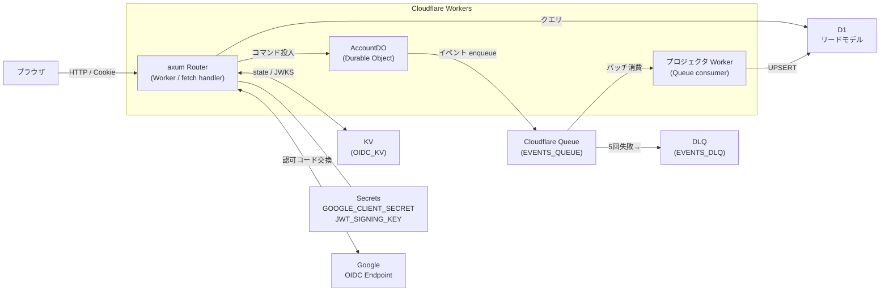
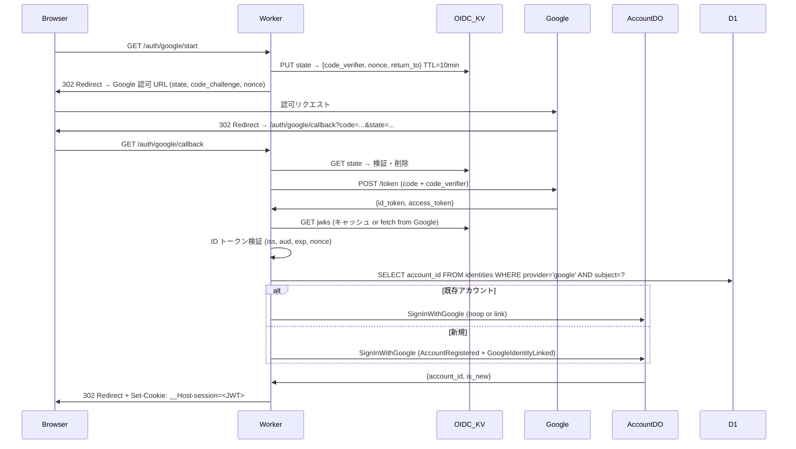

# アカウント基盤 設計書

> バージョン: 0.1.0  
> 作成日: 2026-04-26  
> 対象リポジトリ: `accounts/auth-server`

---

## 目次

1. [概要・目的・非目的](#1-概要目的非目的)
2. [全体アーキテクチャ](#2-全体アーキテクチャ)
3. [ドメインモデル](#3-ドメインモデル)
4. [イベントソーシング](#4-イベントソーシング)
5. [リードモデル（D1）スキーマ](#5-リードモデルd1スキーマ)
6. [Queue とプロジェクション](#6-queue-とプロジェクション)
7. [認証フロー（Google OIDC）](#7-認証フローgoogle-oidc)
8. [HTTP API](#8-http-api)
9. [拡張性](#9-拡張性)
10. [プロジェクト構成](#10-プロジェクト構成)
11. [wrangler.toml 設定例](#11-wranglertoml-設定例)
12. [Atlas マイグレーション運用](#12-atlas-マイグレーション運用)
13. [セキュリティ](#13-セキュリティ)
14. [テスト戦略](#14-テスト戦略)
15. [ローカル起動・検証手順](#15-ローカル起動検証手順)
16. [今後の拡張](#16-今後の拡張)

---

## 1. 概要・目的・非目的

### 目的

Cloudflare Workers（Rust → WASM）上で、拡張可能なアカウント認証基盤を構築する。初期は Google ログイン（OIDC + OAuth）のみを実装し、プロバイダ追加を容易にする設計とする。

### 採用アーキテクチャ

| 関心 | 採用技術 |
|---|---|
| ランタイム | Cloudflare Workers（Rust → WASM via `worker-build`） |
| HTTPフレームワーク | axum 0.8（`tower-service` ブリッジ） |
| データ永続化（コマンド側） | Durable Objects（イベントストア） |
| データ永続化（クエリ側） | D1（リードモデル） |
| 非同期伝播 | Cloudflare Queue（DO → D1 プロジェクタ） |
| 認証 | Google OIDC 認可コードフロー + PKCE |
| セッション | JWT (HS256, 1h) |
| DBマイグレーション | Atlas（sqlite ソース → D1 適用） |

### スコープ外（非目的）

- メールアドレス＋パスワード認証
- MFA（TOTP / SMS）
- リフレッシュトークン（期限切れ時は再 OIDC）
- 管理者 UI

---

## 2. 全体アーキテクチャ



### Cloudflare バインディング一覧

| バインディング名 | 種別 | 用途 |
|---|---|---|
| `ACCOUNT_DO` | Durable Object | Account 集約のイベントストア |
| `READ_DB` | D1 | リードモデル（accounts / identities） |
| `EVENTS_QUEUE` | Queue producer + consumer | DO → プロジェクタへのイベント伝播 |
| `EVENTS_DLQ` | Queue（DLQ） | 処理失敗イベントの隔離 |
| `OIDC_KV` | KV Namespace | OIDC state / nonce / JWKS キャッシュ |
| `GOOGLE_CLIENT_SECRET` | Secret | Google OAuth クライアントシークレット |
| `JWT_SIGNING_KEY` | Secret | セッション JWT 署名鍵（現行） |
| `JWT_PREVIOUS_KEY` | Secret | セッション JWT 署名鍵（ローテ前） |
| `GOOGLE_CLIENT_ID` | Var | Google OAuth クライアント ID |
| `OAUTH_REDIRECT_URI` | Var | コールバック URI |
| `SESSION_TTL_SECS` | Var | JWT 有効期間（デフォルト 3600） |

---

## 3. ドメインモデル

### 集約: `Account`

```
Account {
    id:            UUIDv7          // サーバ採番。ソート可能、PII なし
    status:        AccountStatus   // Pending | Active | Suspended
    primary_email: String
    identities:    Vec<Identity>   // provider + subject のエンティティ集合
    version:       u64             // 楽観ロック用シーケンス
}

Identity {
    provider:       ProviderId     // "google" | 将来: "github" | "apple"
    subject:        String         // プロバイダ発行のユーザー ID
    email:          String
    email_verified: bool
    linked_at:      Timestamp
}
```

### 設計判断

- **Identity は Account 集約内のエンティティ**。独立集約にしない。理由: 「同一 (provider, subject) は1つの Account にしか紐付かない」という不変条件を D1 の PK と lookup-then-route で担保する（強整合は不要、D1 PK の競合で検出できる）。
- **ID は UUIDv7**。メールや sub の決定論的ハッシュにしないのは、メール変更・アカウントマージ時に ID が変わらないようにするため。

### 不変条件

1. `Active` 状態には `identities` が1つ以上必要
2. 同一 `(provider, subject)` は複数の Account に紐付けない
3. `Suspended → Suspended` への遷移は拒否

---

## 4. イベントソーシング

### イベント一覧（初期）

| イベント名 | 概要 |
|---|---|
| `AccountRegistered` | 新 Account が作成された（最初の Identity も含む） |
| `GoogleIdentityLinked` | 既存 Account に Google Identity が追加された |
| `IdentityUnlinked` | Identity が解除された |
| `EmailVerified` | メールの verified フラグが更新された |
| `PrimaryEmailChanged` | primary_email が変更された |
| `AccountSuspended` | アカウントが停止された |
| `AccountReactivated` | アカウントが再有効化された |

### コマンド一覧（初期）

| コマンド名 | 概要 |
|---|---|
| `SignInWithGoogle` | ログイン（新規なら Register、既存なら noop or link）。冪等 |
| `LinkGoogleIdentity` | 追加の Google Identity を既存 Account に紐付ける |
| `UnlinkIdentity` | Identity を解除する |
| `SuspendAccount` | アカウントを停止する |
| `ReactivateAccount` | アカウントを再有効化する |

### イベント・エンベロープ

```json
{
  "event_id":       "01JGVR...",   // UUIDv7
  "aggregate_id":   "01JGVQ...",   // Account の UUIDv7
  "aggregate_type": "Account",
  "type":           "AccountRegistered",
  "schema_version": 1,
  "version":        1,             // この集約内での通し番号
  "occurred_at":    1745000000000, // Unix ミリ秒
  "command_id":     "01JGVP...",   // 元コマンドの UUIDv7 (Idempotency-Key)
  "payload": { ... }
}
```

### Durable Object ストレージ・レイアウト

```
meta:version          → u64  (集約の現在 version)
event:{seq:020}       → envelope JSON  (e.g. event:00000000000000000001)
cmd:{idempotency_key} → 直近コマンド結果 JSON（リプレイ用）
outbox:{seq}          → "pending" | 削除済み（Queue 送出確認用）
```

**楽観ロック**の実装イメージ:

```rust
// Durable Object のコマンドハンドラ内（疑似コード）
let result = state.storage().transaction(|tx| async move {
    let version = tx.get::<u64>("meta:version").await?.unwrap_or(0);
    let current_state = load_events(&tx, version).await?;
    let new_events = domain::decide(&current_state, &cmd)?;
    for ev in &new_events {
        tx.put(&format!("event:{:020}", ev.version), ev).await?;
        tx.put(&format!("outbox:{:020}", ev.version), "pending").await?;
    }
    tx.put("meta:version", version + new_events.len() as u64).await?;
    Ok(new_events)
}).await?;
env.EVENTS_QUEUE.send_batch(&result).await?;
// 送出成功後に outbox キーを削除
```

**冪等性**: リクエストヘッダ `Idempotency-Key` を `cmd:{key}` に保存し、同一キーで再コールされた場合は保存済み結果をそのまま返す。

**スナップショット**: day-1 では実装しない（1アカウントのイベント数はごく少数のため）。将来 N=50 イベントごとに `snapshot:{version}` を保存する拡張ポイントを設ける。

---

## 5. リードモデル（D1）スキーマ

```sql
PRAGMA foreign_keys = ON;

CREATE TABLE accounts (
    id            TEXT    NOT NULL PRIMARY KEY,
    status        TEXT    NOT NULL CHECK (status IN ('Pending', 'Active', 'Suspended')),
    primary_email TEXT    NOT NULL,
    created_at    INTEGER NOT NULL,  -- Unix ミリ秒
    updated_at    INTEGER NOT NULL,
    version       INTEGER NOT NULL
);

CREATE TABLE identities (
    provider        TEXT    NOT NULL,
    subject         TEXT    NOT NULL,
    account_id      TEXT    NOT NULL,
    email           TEXT    NOT NULL,
    email_verified  INTEGER NOT NULL DEFAULT 0,  -- 0 or 1
    linked_at       INTEGER NOT NULL,
    PRIMARY KEY (provider, subject)
);
CREATE INDEX idx_identities_account_id ON identities (account_id);

CREATE TABLE processed_events (
    event_id     TEXT    NOT NULL PRIMARY KEY,
    processed_at INTEGER NOT NULL
);
```

### D1 固有の注意点

- `PRAGMA foreign_keys = ON` は接続ごとに設定が必要（D1 はデフォルト OFF）
- `ALTER TABLE ... DROP COLUMN` は sqlite 3.35+ が必要。D1 のバージョンを事前確認すること
- 外部キー制約は設計に記載するが、D1 側のランタイムで有効化するまではアプリ側で整合性を保つ

---

## 6. Queue とプロジェクション

### メッセージ形式

イベント・エンベロープ（§4 参照）をそのまま JSON シリアライズして送出する。ペイロードが 16 KB を超える場合はコマンド処理時点でエラーを返す。

### 送出フロー

```
AccountDO
  ├─ storage.transaction() → イベント永続化 + outbox フラグ書込
  └─ EVENTS_QUEUE.send_batch() → 送出成功 → outbox フラグ削除

// DO が crash した場合のリカバリ
// 次回コマンド処理時に outbox:{seq} の残存を検出し send_batch でリトライ
// (DO 内 alarm() で定期スイープ: 30s 間隔)
```

### Consumer（プロジェクタ）フロー

```
1. キューからバッチ受信
2. 各メッセージに対して:
   a. INSERT OR IGNORE INTO processed_events(event_id, processed_at)
   b. 行が挿入された場合（= 未処理）のみ UPSERT を実行
      - AccountRegistered → INSERT INTO accounts + identities
      - GoogleIdentityLinked / IdentityUnlinked → INSERT / DELETE identities
      - AccountSuspended / AccountReactivated → UPDATE accounts SET status
      - EmailVerified / PrimaryEmailChanged → UPDATE accounts / identities
3. 一時エラーは最大 5 回リトライ
4. 5 回失敗 → EVENTS_DLQ へルーティング
```

**順序保証**: CF Queue は per-key 順序を保証しないため、`UPDATE accounts SET ... WHERE version < :new_version` のように古いバージョンを上書きしない条件を入れ、順序逆転に耐える。

---

## 7. 認証フロー（Google OIDC）

### フロー図



### OIDC state の KV 構造

```json
{
  "code_verifier": "...",   // PKCE S256 の元値
  "nonce":         "...",   // ID トークン nonce
  "return_to":     "/dashboard"
}
```

- Key: `oidc:state:{state_value}`
- TTL: 600 秒（10 分）
- `state` は 32 バイト CSPRNG ← URLSafe Base64

### セッション JWT

```json
{
  "sub": "01JGVQ...",   // account_id
  "kid": "v1",          // 署名鍵バージョン
  "iat": 1745000000,
  "exp": 1745003600,
  "jti": "01JGVS..."    // ランダム（将来の revoke 用）
}
```

- アルゴリズム: HS256
- 有効期間: `SESSION_TTL_SECS`（デフォルト 3600 秒）
- クッキー: `__Host-session; Secure; HttpOnly; SameSite=Lax; Path=/`
- リフレッシュ: day-1 では未実装。期限切れ時は再 OIDC フローを踏む

---

## 8. HTTP API

| Method | Path | 用途 |
|---|---|---|
| `GET` | `/auth/google/start` | OIDC 開始（state 採番 → 認可 URL へリダイレクト） |
| `GET` | `/auth/google/callback` | コード交換・ID トークン検証・コマンド投入・セッション発行 |
| `POST` | `/auth/logout` | セッションクッキー削除 |
| `GET` | `/me` | 自アカウント情報 + 連携 Identity 一覧（D1 read） |
| `POST` | `/me/identities/google/unlink` | `UnlinkIdentity` コマンド投入 |
| `GET` | `/healthz` | Liveness check（200 固定） |

将来追加予定（実装しない）:
- `POST /admin/accounts/:id/suspend`
- `GET /auth/github/start`, `GET /auth/github/callback`

### レスポンス形式

- エラー: `{ "error": "error_code", "message": "..." }` (JSON)
- 成功 `/me`:

```json
{
  "id":            "01JGVQ...",
  "status":        "Active",
  "primary_email": "user@example.com",
  "identities": [
    { "provider": "google", "subject": "108...", "email": "...", "email_verified": true }
  ]
}
```

---

## 9. 拡張性

### IdentityProvider トレイト

```rust
// src/auth/provider.rs
#[async_trait]
pub trait IdentityProvider: Send + Sync {
    fn id(&self) -> &'static str;   // "google", "github", etc.
    async fn start(&self, ctx: &StartCtx) -> Result<StartResponse>;
    async fn callback(&self, ctx: &CallbackCtx) -> Result<VerifiedIdentity>;
}

pub struct VerifiedIdentity {
    pub provider:       String,
    pub subject:        String,
    pub email:          String,
    pub email_verified: bool,
}
```

- `GoogleProvider` が最初の実装
- ルータは `/auth/:provider/start` と `/auth/:provider/callback` をジェネリックにマウント
- コマンド層 (`SignInWithGoogle` など) は `VerifiedIdentity` のみを受け取り、プロバイダ非依存

### 新プロバイダ追加手順（概要）

1. `src/auth/providers/` 配下に新モジュールを作成し `IdentityProvider` を実装
2. `src/http/router.rs` のプロバイダレジストリに登録
3. `wrangler.toml` に必要な `[vars]` / `wrangler secret put` を追加
4. コマンド/イベント体系はそのまま流用（`VerifiedIdentity` に詰めるだけ）

---

## 10. プロジェクト構成

```
auth-server/
├── Cargo.toml
├── wrangler.toml
├── db/
│   ├── atlas.hcl
│   ├── schema.sql          ← D1 スキーマのソース・オブ・トゥルース
│   └── migrations/         ← atlas migrate diff が生成するファイル
├── docs/
│   └── design.md           ← 本ファイル
└── src/
    ├── lib.rs              # #[event(fetch)] エントリ, Router 構築, DO export 宣言
    ├── http/
    │   ├── mod.rs          # axum Router 組み立て
    │   ├── auth.rs         # /auth/:provider/* ハンドラ
    │   ├── me.rs           # /me ハンドラ
    │   └── error.rs        # axum エラーマッピング
    ├── auth/
    │   ├── mod.rs
    │   ├── provider.rs     # IdentityProvider trait, VerifiedIdentity
    │   ├── providers/
    │   │   └── google.rs   # GoogleProvider
    │   ├── session.rs      # JWT 発行・検証
    │   └── jwks.rs         # JWKS フェッチ・キャッシュ
    ├── commands/
    │   ├── mod.rs
    │   ├── dto.rs          # コマンド DTO
    │   └── dispatcher.rs   # DO スタブ呼び出し
    ├── domain/
    │   ├── mod.rs
    │   ├── account.rs      # Account 集約（状態）
    │   ├── events.rs       # イベント定義
    │   └── logic.rs        # decide(state, cmd) → Vec<Event>, apply(state, ev) → state
    ├── durable/
    │   ├── mod.rs
    │   └── account_do.rs   # AccountDO: fetch ハンドラ, ストレージ操作, outbox
    ├── projections/
    │   ├── mod.rs
    │   └── consumer.rs     # Queue consumer, D1 UPSERT
    ├── queries/
    │   ├── mod.rs
    │   └── account.rs      # /me 向け D1 read
    └── infra/
        ├── mod.rs
        ├── env.rs          # バインディング取得ヘルパ
        ├── ids.rs          # UUIDv7 生成
        ├── kv.rs           # KV ラッパ（TTL 付き PUT/GET）
        └── time.rs         # タイムスタンプ取得
```

**設計原則**:
- `domain/logic.rs` の `decide` / `apply` は純粋関数（非同期・I/O なし）→ 単体テストが容易
- Durable Object の fetch ハンドラは `durable/` にのみ存在し、`domain/` を呼び出す
- `infra/` はランタイム依存の具象実装のみ（テストではスタブで差し替え可）

---

## 11. wrangler.toml 設定例

```toml
name              = "auth-server"
main              = "build/index.js"
compatibility_date = "2026-04-24"

[build]
command = "cargo install -q 'worker-build@^0.8' && worker-build --release --panic-unwind"

# ── Durable Objects ──────────────────────────────────────────
[[durable_objects.bindings]]
name       = "ACCOUNT_DO"
class_name = "AccountDO"

[[migrations]]
tag             = "v1"
new_classes     = ["AccountDO"]

# ── D1 ───────────────────────────────────────────────────────
[[d1_databases]]
binding      = "READ_DB"
database_name = "auth-server-read"
database_id   = "<D1_DATABASE_ID>"  # wrangler d1 create で取得

# ── Queues ───────────────────────────────────────────────────
[[queues.producers]]
binding    = "EVENTS_QUEUE"
queue      = "auth-events"

[[queues.consumers]]
queue            = "auth-events"
max_batch_size   = 100
max_batch_timeout = 5        # 秒
max_retries      = 5
dead_letter_queue = "auth-events-dlq"

# ── KV ───────────────────────────────────────────────────────
[[kv_namespaces]]
binding = "OIDC_KV"
id      = "<KV_NAMESPACE_ID>"   # wrangler kv namespace create で取得

# ── Vars（非シークレット） ────────────────────────────────────
[vars]
GOOGLE_CLIENT_ID  = "<YOUR_CLIENT_ID>"
OAUTH_REDIRECT_URI = "https://auth-server.example.com/auth/google/callback"
SESSION_TTL_SECS  = "3600"
```

### シークレット設定（デプロイ前に実行）

```bash
wrangler secret put GOOGLE_CLIENT_SECRET
wrangler secret put JWT_SIGNING_KEY
wrangler secret put JWT_PREVIOUS_KEY   # ローテ時のみ
```

---

## 12. Atlas マイグレーション運用

### 構成

`db/atlas.hcl` はソース・オブ・トゥルースとして `db/schema.sql` を参照する（既存設定を維持）。

```hcl
env "local" {
  src = "file://schema.sql"
  url = getenv("DATABASE_URL")    # sqlite://dev.db
  dev = "sqlite://dev?mode=memory"
}
```

### ローカル開発フロー

```bash
# 1. スキーマ変更後、マイグレーションファイルを生成
atlas migrate diff <migration_name> \
  --dev-url "sqlite://dev?mode=memory" \
  --to     "file://db/schema.sql" \
  --dir    "file://db/migrations" \
  --env    local

# 2. ローカル D1 (sqlite) に適用
atlas migrate apply \
  --url "sqlite://./db/dev.db" \
  --dir "file://db/migrations"
```

### Cloudflare D1 への適用

Atlas は D1 ドライバを持たないため、生成した SQL を `wrangler d1 execute` で適用する。

```bash
# 1. 適用予定 SQL を確認（dry-run）
atlas migrate apply \
  --dir "file://db/migrations" \
  --dry-run \
  --format '{{ sql . }}' \
  > /tmp/migration.sql

# 2. D1 に適用（本番）
wrangler d1 execute READ_DB --file=/tmp/migration.sql

# 3. バージョン管理テーブルを手動更新
wrangler d1 execute READ_DB \
  --command "INSERT INTO _atlas_revisions (version, applied_at) VALUES ('<version>', unixepoch() * 1000)"
```

`_atlas_revisions` テーブルは `schema.sql` に追加して管理する:

```sql
CREATE TABLE _atlas_revisions (
    version    TEXT    NOT NULL PRIMARY KEY,
    applied_at INTEGER NOT NULL
);
```

### D1 の制約事項

- `PRAGMA foreign_keys = ON` は接続ごとに必要（Consumer Worker の起動時に実行）
- `ALTER TABLE ... DROP COLUMN` の可否は D1 が使用する SQLite バージョンに依存
- バッチ実行は `wrangler d1 execute --file` で複数ステートメントを一括適用可能

---

## 13. セキュリティ

### CSRF / リプレイ対策

| 脅威 | 対策 |
|---|---|
| CSRF | `state` = 32 バイト CSPRNG, KV 単発消費（使用後即削除） |
| nonce リプレイ | `nonce` を ID トークンに紐付け。KV から取得・削除済みであれば再利用不可 |
| コード傍受 | PKCE S256 必須（`code_verifier` はブラウザに渡さない） |
| セッション固定 | ログイン完了時に必ず新規 JWT を発行 |

### クッキー設定

```
Set-Cookie: __Host-session=<JWT>; Secure; HttpOnly; SameSite=Lax; Path=/
```

- `__Host-` プレフィックスにより `Secure` + `Path=/` + `Domain` 省略が強制される

### JWT 鍵ローテーション

- `JWT_SIGNING_KEY`（現行）と `JWT_PREVIOUS_KEY`（旧鍵）の2本を常時保持
- JWT ヘッダの `kid` フィールドで使用鍵を識別
- 検証時は `kid` に応じて適切な鍵を選択（旧鍵のトークンも有効期間中は受け入れる）
- 月次で新鍵へ切り替え: `JWT_PREVIOUS_KEY = 旧 JWT_SIGNING_KEY`, `JWT_SIGNING_KEY = 新鍵`

### その他

- **CORS**: `vars.ALLOWED_ORIGINS` 許可リストのみ。`*` は禁止
- **レート制限**: Cloudflare Rate Limiting Rules を `/auth/google/start` に設定（IP 単位・分間 10 req）
- **ログ**: `code`, `id_token`, メールアドレス本文は絶対にログに出さない。`subject` は SHA-256 ハッシュで記録

---

## 14. テスト戦略

### ユニットテスト（I/O なし）

```rust
// domain/logic.rs のテスト例
#[test]
fn sign_in_new_account_emits_account_registered() {
    let state = AccountState::empty();
    let cmd = SignInWithGoogle { subject: "108..".into(), email: "a@b.com".into(), .. };
    let events = decide(&state, &cmd).unwrap();
    assert!(matches!(events[0].payload, EventPayload::AccountRegistered { .. }));
}
```

- `decide(state, cmd) → Vec<Event>` と `apply(state, event) → AccountState` は純粋関数
- テストデータは `AccountState::empty()` から構築

### DO 統合テスト

- `wrangler dev --local`（miniflare 内蔵）で実 DO を起動
- `tests/` 配下に Worker を置き、`POST /commands/sign-in-with-google` を HTTP で叩く
- DO ストレージを `wrangler dev` の DevTools で検査

### プロジェクタテスト

```bash
# ローカル D1 に対してプロジェクタ consumer 関数を単体実行
# エンベロープ JSON を stdin で渡し D1 state を assert
wrangler d1 execute READ_DB --local \
  --command "SELECT * FROM accounts"
```

### E2E テスト

- Google の `discovery`, `/token`, `/certs` をモック Worker で立てる
- フル sign-in フロー（`/auth/google/start` → callback → `/me`）を自動化
- `wrangler dev --local` 環境で完結させる（外部 Google への通信なし）

### イベントスキーマ・スナップショット

- `schema_version` フィールドを持つエンベロープ JSON の golden ファイルを `tests/snapshots/` に置く
- シリアライズ結果と diff を取り、意図しないフォーマット変更を検出

---

## 15. ローカル起動・検証手順

### 初回セットアップ

```bash
# 1. ローカル sqlite に D1 スキーマを適用
cd db
atlas migrate diff init \
  --dev-url "sqlite://dev?mode=memory" \
  --to     "file://schema.sql" \
  --dir    "file://migrations"
atlas migrate apply --url "sqlite://./dev.db" --dir "file://migrations"

# 2. Google OAuth クライアントを作成し .env に記載
# GOOGLE_CLIENT_ID=...
# GOOGLE_CLIENT_SECRET=...（wrangler secret put で登録）

# 3. Wrangler dev 起動
cd ..
npx wrangler dev
# または: mise run dev
```

### 動作確認手順

```bash
# 1. Liveness
curl http://localhost:8787/healthz
# → 200 OK

# 2. OIDC 開始（ブラウザで開く）
open "http://localhost:8787/auth/google/start"
# Google 認可画面 → callback → __Host-session クッキー設定

# 3. 自アカウント取得
curl -b "__Host-session=<token>" http://localhost:8787/me
# → { "id": "...", "status": "Active", "identities": [...] }

# 4. D1 状態確認
npx wrangler d1 execute READ_DB --local \
  --command "SELECT * FROM accounts"

# 5. Queue → D1 反映確認
# wrangler tail でプロジェクタ consumer ログを観測
npx wrangler tail --format pretty
```

### チェックリスト

- [ ] `/healthz` が 200 を返す
- [ ] Google 認可 → callback で `__Host-session` クッキーがセットされる
- [ ] `/me` がアカウント情報と Identity を返す
- [ ] D1 `accounts` + `identities` に行が挿入されている
- [ ] DO ストレージに `event:00000000000000000001` が存在する
- [ ] `processed_events` にイベント ID が記録されている

---

## 16. 今後の拡張

本タスクのスコープ外だが、設計上のフックとして記録しておく。

### 追加プロバイダ

`IdentityProvider` トレイト（§9 参照）を実装するだけで追加可能。最優先候補:
- GitHub（開発者向けサービス）
- Apple Sign In（iOS 対応が必要な場合）

### リフレッシュトークン

JWT を short-lived（15 分）にして、KV ベースの opaque refresh token（7 日）を発行する。`revoke` エンドポイントで即時失効可能にする。

### スナップショット

`event:{seq}` が 50 を超えた集約に対して `snapshot:{version}` を保存し、リプレイコストを削減する。しきい値は configurable にする。

### 監査ログ

D1 に `account_events_log(event_id, aggregate_id, version, type, occurred_at)` テーブルを追加し、プロジェクタが投影と同時に書き込む。ペイロードは含めない（PII 保護）。

### 管理者 API

`/admin/accounts/:id/suspend` 等のエンドポイントを追加。アクセス制御は CF Access または内部 Bearer トークンで行う。

### レート制限の強化

`RateLimitDO`（Durable Object による IP 単位トークンバケット）を実装し、CF Rate Limiting Rules との二重防御にする。
