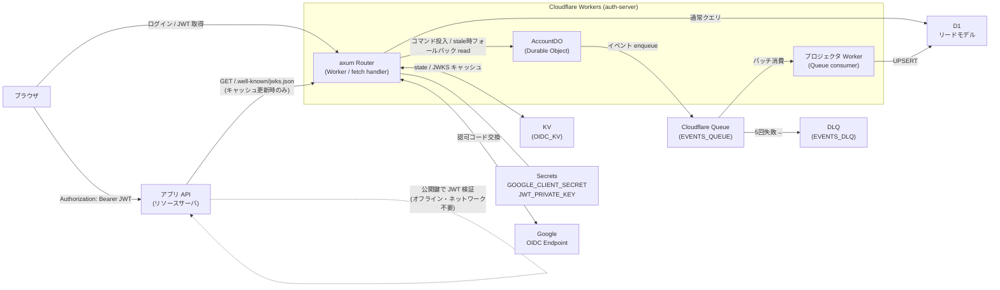
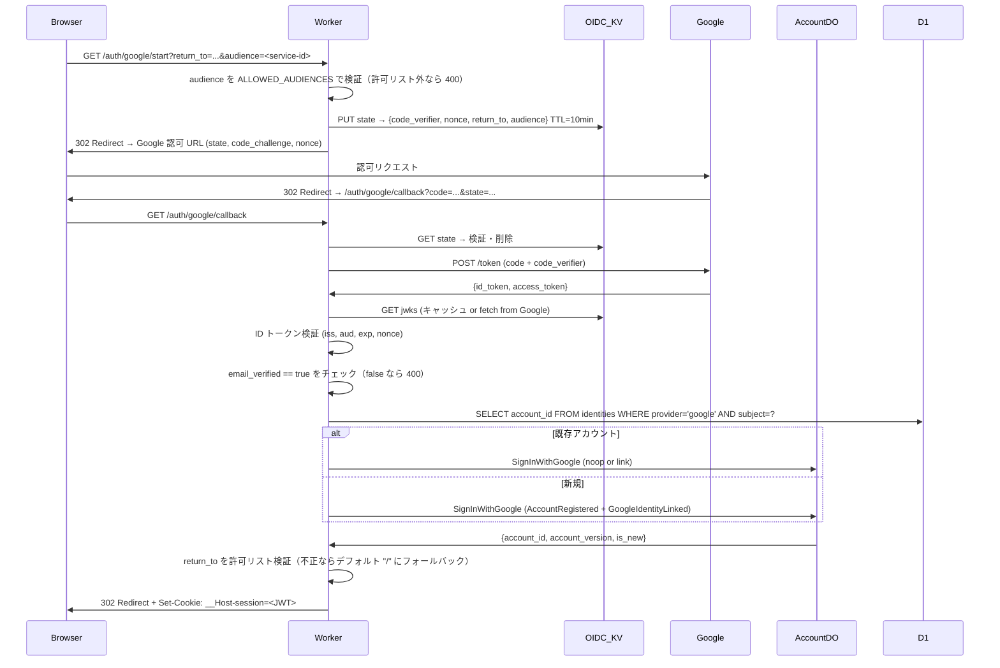

# アカウント基盤 設計書

> バージョン: 0.1.0  
> 作成日: 2026-04-26  
> 対象リポジトリ: `accounts/auth-server`

---

## 目次

1. [概要・目的・非目的](#1-概要目的非目的)
2. [全体アーキテクチャ](#2-全体アーキテクチャ)
3. [ドメインモデル](#3-ドメインモデル)
4. [イベントソーシング](#4-イベントソーシング)
5. [リードモデル（D1）スキーマ](#5-リードモデルd1スキーマ)
6. [Queue とプロジェクション](#6-queue-とプロジェクション)
7. [認証フロー（Google OIDC）](#7-認証フローgoogle-oidc)
8. [HTTP API](#8-http-api)
9. [他サービスからの JWT 検証（リソースサーバ向け）](#9-他サービスからの-jwt-検証リソースサーバ向け)
10. [拡張性](#10-拡張性)
11. [プロジェクト構成](#11-プロジェクト構成)
12. [wrangler.toml 設定例](#12-wranglertoml-設定例)
13. [Atlas マイグレーション運用](#13-atlas-マイグレーション運用)
14. [セキュリティ](#14-セキュリティ)
15. [テスト戦略](#15-テスト戦略)
16. [ローカル起動・検証手順](#16-ローカル起動検証手順)
17. [今後の拡張](#17-今後の拡張)

---

## 1. 概要・目的・非目的

### 位置づけ

本サービスは、自社の複数アプリケーション API（リソースサーバ）が共通で利用する**中央認証基盤**である。ブラウザ上のユーザーに対して Google ログインを提供し、発行した JWT を各アプリケーション API がオフラインで検証できる構造（RS256 + JWKS 公開）を採用する。各アプリ API は auth-server へ問い合わせを行わず、キャッシュした公開鍵で自律的に認証を完結させる。

```
ブラウザ ──認可フロー──▶ auth-server ──JWT 発行──▶ ブラウザ
                               │
                               └─ JWKS 公開
                                        ▲
アプリ API ◀──Bearer JWT── ブラウザ     │
    │                                    │
    └─────────────── JWKS フェッチ ──────┘
    （kid 一致の公開鍵で署名検証・オフライン完結）
```

### 目的

Cloudflare Workers（Rust → WASM）上で、拡張可能なアカウント認証基盤を構築する。初期は Google ログイン（OIDC + OAuth）のみを実装し、プロバイダ追加を容易にする設計とする。

### 採用アーキテクチャ

| 関心 | 採用技術 |
|---|---|
| ランタイム | Cloudflare Workers（Rust → WASM via `worker-build`） |
| HTTPフレームワーク | axum 0.8（`tower-service` ブリッジ） |
| データ永続化（コマンド側） | Durable Objects（イベントストア） |
| データ永続化（クエリ側） | D1（リードモデル） |
| 非同期伝播 | Cloudflare Queue（DO → D1 プロジェクタ） |
| 認証 | Google OIDC 認可コードフロー + PKCE |
| セッション | JWT (RS256, 1h) + JWKS 公開 |
| DBマイグレーション | Atlas（sqlite ソース → D1 適用） |

### スコープ外（非目的）

- メールアドレス＋パスワード認証
- MFA（TOTP / SMS）
- リフレッシュトークン（期限切れ時は再 OIDC）
- 管理者 UI

---

## 2. 全体アーキテクチャ



### Cloudflare バインディング一覧

| バインディング名 | 種別 | 用途 |
|---|---|---|
| `ACCOUNT_DO` | Durable Object | Account 集約のイベントストア |
| `READ_DB` | D1 | リードモデル（accounts / identities） |
| `EVENTS_QUEUE` | Queue producer + consumer | DO → プロジェクタへのイベント伝播 |
| `EVENTS_DLQ` | Queue（DLQ） | 処理失敗イベントの隔離 |
| `OIDC_KV` | KV Namespace | OIDC state / nonce / Google JWKS キャッシュ |
| `GOOGLE_CLIENT_SECRET` | Secret | Google OAuth クライアントシークレット |
| `JWT_PRIVATE_KEY` | Secret | JWT 署名用 RSA 秘密鍵 PEM（現行, PKCS#8） |
| `JWT_PREVIOUS_PRIVATE_KEY` | Secret | JWT 署名用 RSA 秘密鍵 PEM（ローテ前） |
| `GOOGLE_CLIENT_ID` | Var | Google OAuth クライアント ID |
| `OAUTH_REDIRECT_URI` | Var | コールバック URI |
| `JWT_ISSUER` | Var | JWT `iss` クレーム（例: `https://auth.example.com`） |
| `JWT_DEFAULT_AUDIENCE` | Var | JWT `aud` のデフォルト値（`audience` クエリ未指定時に使用） |
| `ALLOWED_AUDIENCES` | Var | JWT `aud` の許可リスト（カンマ区切り）。未設定時は `JWT_DEFAULT_AUDIENCE` のみを許可 |
| `SESSION_TTL_SECS` | Var | JWT 有効期間（デフォルト 3600） |

### 整合性モデル

本設計は CQRS + イベントソーシングを採用し、Durable Object を Account 集約の正とする。D1 は Queue consumer によって非同期更新されるリードモデルであり、**最新状態への反映遅延を許容する projection** として扱う。

- コマンド処理・不変条件の判定・セキュリティ上クリティカルな現在状態は AccountDO を正とする
- 通常の参照は D1 を優先し、低レイテンシ・高スループットの read path とする
- 認証直後や Queue lag 中に D1 が未反映または古い場合は、AccountDO へフォールバックして read-your-writes を保証する
- D1 に行が存在しないことだけでは「存在しない Account」と断定しない。セッションが有効であれば projection lag の可能性があるため AccountDO で確認する

---

## 3. ドメインモデル

### 集約: `Account`

```
Account {
    id:            UUIDv7          // サーバ採番。ソート可能、PII なし
    status:        AccountStatus   // Pending | Active | Suspended
    primary_email: String
    identities:    Vec<Identity>   // provider + subject のエンティティ集合
    version:       u64             // 楽観ロック用シーケンス
}

Identity {
    provider:       ProviderId     // "google" | 将来: "github" | "apple"
    subject:        String         // プロバイダ発行のユーザー ID
    email:          String
    email_verified: bool
    linked_at:      Timestamp
}
```

### 設計判断

- **Identity は Account 集約内のエンティティ**。独立集約にしない。理由: 「同一 (provider, subject) は1つの Account にしか紐付かない」という不変条件を D1 の PK と lookup-then-route で担保する（強整合は不要、D1 PK の競合で検出できる）。
- **ID は UUIDv7**。メールや sub の決定論的ハッシュにしないのは、メール変更・アカウントマージ時に ID が変わらないようにするため。

### 不変条件

1. `Active` 状態には `identities` が1つ以上必要
2. 同一 `(provider, subject)` は複数の Account に紐付けない
3. `Suspended → Suspended` への遷移は拒否
4. **`Identity` の登録には `email_verified == true` が必須**。プロバイダから `email_verified: false` の ID トークンを受領した場合はコマンドを拒否する（§7.4 参照）

---

## 4. イベントソーシング

### イベント一覧（初期）

| イベント名 | 概要 |
|---|---|
| `AccountRegistered` | 新 Account が作成された（最初の Identity も含む） |
| `GoogleIdentityLinked` | 既存 Account に Google Identity が追加された |
| `IdentityUnlinked` | Identity が解除された |
| `EmailVerified` | メールの verified フラグが更新された |
| `PrimaryEmailChanged` | primary_email が変更された |
| `AccountSuspended` | アカウントが停止された |
| `AccountReactivated` | アカウントが再有効化された |

### コマンド一覧（初期）

| コマンド名 | 概要 |
|---|---|
| `SignInWithGoogle` | ログイン（新規なら Register、既存なら noop or link）。冪等 |
| `LinkGoogleIdentity` | 追加の Google Identity を既存 Account に紐付ける |
| `UnlinkIdentity` | Identity を解除する |
| `SuspendAccount` | アカウントを停止する |
| `ReactivateAccount` | アカウントを再有効化する |

### イベント・エンベロープ

```json
{
  "event_id":       "01JGVR...",   // UUIDv7
  "aggregate_id":   "01JGVQ...",   // Account の UUIDv7
  "aggregate_type": "Account",
  "type":           "AccountRegistered",
  "schema_version": 1,
  "version":        1,             // この集約内での通し番号
  "occurred_at":    1745000000000, // Unix ミリ秒
  "command_id":     "01JGVP...",   // 元コマンドの UUIDv7 (Idempotency-Key)
  "payload": { ... }
}
```

### Durable Object ストレージ・レイアウト

```
meta:version          → u64  (集約の現在 version)
event:{seq:020}       → envelope JSON  (e.g. event:00000000000000000001)
cmd:{idempotency_key} → 直近コマンド結果 JSON（リプレイ用）
outbox:{seq}          → "pending" | 削除済み（Queue 送出確認用）
```

**楽観ロック**の実装イメージ:

```rust
// Durable Object のコマンドハンドラ内（疑似コード）
let result = state.storage().transaction(|tx| async move {
    let version = tx.get::<u64>("meta:version").await?.unwrap_or(0);
    let current_state = load_events(&tx, version).await?;
    let new_events = domain::decide(&current_state, &cmd)?;
    for ev in &new_events {
        tx.put(&format!("event:{:020}", ev.version), ev).await?;
        tx.put(&format!("outbox:{:020}", ev.version), "pending").await?;
    }
    tx.put("meta:version", version + new_events.len() as u64).await?;
    Ok(new_events)
}).await?;
env.EVENTS_QUEUE.send_batch(&result).await?;
// 送出成功後に outbox キーを削除
```

**冪等性**: リクエストヘッダ `Idempotency-Key` を `cmd:{key}` に保存し、同一キーで再コールされた場合は保存済み結果をそのまま返す。

**スナップショット**: day-1 では実装しない（1アカウントのイベント数はごく少数のため）。将来 N=50 イベントごとに `snapshot:{version}` を保存する拡張ポイントを設ける。

### Durable Object read API

AccountDO はコマンド投入用の write API に加えて、`/me` fallback 用の read-only API を持つ。

```
GET /accounts/{account_id}/current
→ Account 集約イベントをリプレイして current view を返す
→ イベント追加・outbox 更新・D1 同期書き込みは行わない
```

この API は通常 read path ではなく、D1 が存在しない、または D1 の `accounts.version` が要求バージョンに満たない場合のみ呼び出す。AccountDO 側では必要に応じて `cmd:{idempotency_key}` とは別に `view:current` キャッシュを持ってよいが、キャッシュはイベント追加後に同一 transaction 内で無効化または更新する。

---

## 5. リードモデル（D1）スキーマ

```sql
PRAGMA foreign_keys = ON;

CREATE TABLE accounts (
    id            TEXT    NOT NULL PRIMARY KEY,
    status        TEXT    NOT NULL CHECK (status IN ('Pending', 'Active', 'Suspended')),
    primary_email TEXT    NOT NULL,
    created_at    INTEGER NOT NULL,  -- Unix ミリ秒
    updated_at    INTEGER NOT NULL,
    version       INTEGER NOT NULL
);

CREATE TABLE identities (
    provider        TEXT    NOT NULL,
    subject         TEXT    NOT NULL,
    account_id      TEXT    NOT NULL,
    email           TEXT    NOT NULL,
    email_verified  INTEGER NOT NULL DEFAULT 0,  -- 0 or 1
    linked_at       INTEGER NOT NULL,
    PRIMARY KEY (provider, subject)
);
CREATE INDEX idx_identities_account_id ON identities (account_id);

CREATE TABLE processed_events (
    event_id     TEXT    NOT NULL PRIMARY KEY,
    processed_at INTEGER NOT NULL
);
```

`accounts.version` は Account 集約のイベントシーケンスを投影した値であり、D1 の鮮度判定に使う。`/me` など read-your-writes が必要な API は、セッションに含まれる `account_version` と D1 の `accounts.version` を比較し、D1 が必要バージョンに追いついている場合のみ D1 の結果を返す。

### D1 固有の注意点

- `PRAGMA foreign_keys = ON` は接続ごとに設定が必要（D1 はデフォルト OFF）
- `ALTER TABLE ... DROP COLUMN` は sqlite 3.35+ が必要。D1 のバージョンを事前確認すること
- 外部キー制約は設計に記載するが、D1 側のランタイムで有効化するまではアプリ側で整合性を保つ
- D1 は非同期 projection であり、Queue lag 中は古い値を返しうる。読み取り側は `version` による鮮度判定を行う

---

## 6. Queue とプロジェクション

### メッセージ形式

イベント・エンベロープ（§4 参照）をそのまま JSON シリアライズして送出する。ペイロードが 16 KB を超える場合はコマンド処理時点でエラーを返す。

### 送出フロー

```
AccountDO
  ├─ storage.transaction() → イベント永続化 + outbox フラグ書込
  └─ EVENTS_QUEUE.send_batch() → 送出成功 → outbox フラグ削除

// DO が crash した場合のリカバリ
// 次回コマンド処理時に outbox:{seq} の残存を検出し send_batch でリトライ
// (DO 内 alarm() で定期スイープ: 30s 間隔)
```

### Consumer（プロジェクタ）フロー

```
1. キューからバッチ受信
2. 各メッセージに対して:
   a. INSERT OR IGNORE INTO processed_events(event_id, processed_at)
   b. 行が挿入された場合（= 未処理）のみ UPSERT を実行
      - AccountRegistered → INSERT INTO accounts + identities
      - GoogleIdentityLinked / IdentityUnlinked → INSERT / DELETE identities
      - AccountSuspended / AccountReactivated → UPDATE accounts SET status
      - EmailVerified / PrimaryEmailChanged → UPDATE accounts / identities
3. 一時エラーは最大 5 回リトライ
4. 5 回失敗 → EVENTS_DLQ へルーティング
```

**順序保証**: CF Queue は per-key 順序を保証しないため、`UPDATE accounts SET ... WHERE version < :new_version` のように古いバージョンを上書きしない条件を入れ、順序逆転に耐える。

**read-your-writes**: Queue 反映完了を同期的には待たない。コマンド完了レスポンスには AccountDO が確定した `account_id` と `account_version` を含め、セッション JWT にも `account_version` を埋め込む。読み取り側は D1 の `version` が要求バージョン未満の場合に AccountDO から現在状態を取得する。

**観測指標**:

- `projection_lag_ms`: `processed_at - occurred_at`
- `/me` の D1 hit 率
- `/me` の AccountDO fallback 率
- AccountDO fallback 時の p50/p95/p99 レイテンシ
- DLQ 件数と event type 別の失敗数

---

## 7. 認証フロー（Google OIDC）

### フロー図



### OIDC state の KV 構造

```json
{
  "code_verifier": "...",   // PKCE S256 の元値
  "nonce":         "...",   // ID トークン nonce
  "return_to":     "/dashboard",
  "audience":      "app-api"  // 発行するJWTのaud。未指定時はJWT_DEFAULT_AUDIENCEで補完
}
```

- Key: `oidc:state:{state_value}`
- TTL: 600 秒（10 分）
- `state` は 32 バイト CSPRNG ← URLSafe Base64

### return_to の検証ルール（オープンリダイレクト対策）

`return_to` はサインイン開始時（`/auth/google/start`）にクエリパラメータとして受け取り、KV に保存する。コールバック処理でリダイレクト先として使用する前に以下を検証し、**いずれかに違反したらデフォルト `/` にフォールバック**する。エラーは返さない（攻撃観測を防ぐ）。

| 条件 | 理由 |
|---|---|
| `/` で始まること | 絶対 URL（`https://evil.com`）を拒否 |
| `//` で始まらないこと | プロトコル相対 URL（`//evil.com`）を拒否 |
| `\` を含まないこと | `\evil.com` がブラウザでホスト名に解釈されるケースを排除 |
| URL デコード後も同条件を満たすこと | 二重エンコード（`%2F%2F`）によるバイパスを防ぐ |

```rust
// 疑似コード: return_to サニタイザ
fn sanitize_return_to(raw: &str) -> &str {
    let decoded = percent_decode(raw);
    if decoded.starts_with('/') && !decoded.starts_with("//") && !decoded.contains('\\') {
        raw   // 元の（エンコード済み）値をそのまま使う
    } else {
        "/"
    }
}
```

### email_verified 検証ルール（未検証メール対策）

Google は `hd`（ホステッドドメイン）以外のアカウントで稀に `email_verified: false` を返す。この場合は認証を拒否する。

- ID トークン検証（iss/aud/exp/nonce）の直後にチェック
- `email_verified == false` の場合: `400 Bad Request`、ボディ `{"error": "email_not_verified"}`
- Account 集約の不変条件（§3）とも整合する

### セッション JWT

```json
{
  "iss": "https://auth.example.com",   // JWT_ISSUER の値
  "sub": "01JGVQ...",                  // account_id
  "aud": "app-api",                    // JWT_DEFAULT_AUDIENCE の値（具体的なサービス識別子）
  "kid": "v1",                         // 署名鍵バージョン（JWKS の kid と対応）
  "iat": 1745000000,
  "exp": 1745003600,
  "jti": "01JGVS...",                  // ランダム（将来の revoke 用）
  "account_version": 1                 // 発行時点で read-your-writes に必要な最小 Account version
}
```

- アルゴリズム: **RS256**（RSA 2048-bit）
- 秘密鍵: `JWT_PRIVATE_KEY` Secret（PKCS#8 PEM）で署名
- 公開鍵: `/.well-known/jwks.json` で配布（各アプリ API はここから取得）
- 有効期間: `SESSION_TTL_SECS`（デフォルト 3600 秒）
- クッキー: `__Host-session; Secure; HttpOnly; SameSite=Lax; Path=/`
- リフレッシュ: day-1 では未実装。期限切れ時は再 OIDC フローを踏む
- `account_version` は auth-server 内の `/me` 鮮度判定に使う。リソースサーバー側の認可判定には使わず、通常は `iss` / `aud` / `exp` / `sub` の検証のみでよい

#### `aud` の設計方針（トークン混用攻撃対策）

`aud` に汎用的な `"default"` を使うと、複数のリソースサーバーが同じ `aud` を受け入れることになり、Service A 向けのトークンが Service B でも有効になるトークン混用攻撃が成立する。

- `ALLOWED_AUDIENCES` Var（カンマ区切り）に登録済みのサービス識別子のみを `aud` として発行できる
- `/auth/google/start?audience=<service-id>` でクライアントが使用するサービスを指定。未指定時は `JWT_DEFAULT_AUDIENCE` にフォールバック
- 許可リスト外の `audience` を指定した場合はログイン開始時点で `400 {"error":"invalid_audience"}` を返す（攻撃面の最小化）
- 発行する JWT の `aud` は**単一文字列**を維持（配列化しない）
- `ALLOWED_AUDIENCES` 未設定時は `JWT_DEFAULT_AUDIENCE` のみを許可リストとして動作（後方互換）

各リソースサーバー側では §9.4 の検証ステップで **`aud` が自サービス識別子と完全一致すること**を必須とし、`"default"` や `*` など曖昧な値での受け入れを禁止する。

---

## 8. HTTP API

| Method | Path | 用途 |
|---|---|---|
| `GET` | `/auth/google/start` | OIDC 開始（state 採番 → 認可 URL へリダイレクト）。クエリ: `?return_to=<path>&audience=<service-id>`。`audience` が `ALLOWED_AUDIENCES` 外なら `400 invalid_audience` |
| `GET` | `/auth/google/callback` | コード交換・ID トークン検証・コマンド投入・セッション発行 |
| `POST` | `/auth/logout` | セッションクッキー削除 |
| `GET` | `/me` | 自アカウント情報 + 連携 Identity 一覧（D1 read + stale時 AccountDO fallback） |
| `POST` | `/me/identities/google/unlink` | `UnlinkIdentity` コマンド投入 |
| `GET` | `/.well-known/jwks.json` | **公開鍵セット（RFC 7517）。アプリ API が JWT 検証に使用** |
| `GET` | `/.well-known/openid-configuration` | Discovery（`issuer`, `jwks_uri` 等の最小実装） |
| `GET` | `/healthz` | Liveness check（200 固定） |

将来追加予定（実装しない）:
- `POST /admin/accounts/:id/suspend`
- `GET /auth/github/start`, `GET /auth/github/callback`

### レスポンス形式

- エラー: `{ "error": "error_code", "message": "..." }` (JSON)
- 成功 `/me`:

```json
{
  "id":            "01JGVQ...",
  "status":        "Active",
  "primary_email": "user@example.com",
  "version":       1,
  "identities": [
    { "provider": "google", "subject": "108...", "email": "...", "email_verified": true }
  ]
}
```

### `/me` の読み取り戦略

`/me` は通常 D1 から読む。認証直後は Queue → D1 projection が未反映の可能性があるため、セッション JWT の `sub` と `account_version` を使って D1 の鮮度を判定する。

```rust
// 疑似コード
let session = verify_session(cookie)?;
let view = d1.get_account_with_identities(&session.sub).await?;

if let Some(view) = view {
    if view.version >= session.account_version {
        return Ok(view);
    }
}

let fresh = account_do.read_current_account(&session.sub).await?;
Ok(fresh)
```

- D1 に行がない場合、または `accounts.version < session.account_version` の場合は AccountDO にフォールバックする
- AccountDO fallback は read-only fetch とし、イベント追加や D1 への同期書き込みは行わない
- fallback 結果を返した後、必要に応じて projection repair 用の Queue message を投げてもよい。ただし day-1 では outbox/alarm と DLQ 監視を優先し、同期 repair は必須にしない
- この方式が保証するのは「セッション発行時点の自分の書き込みを読めること」であり、セッション発行後に別経路で行われた停止・更新を常に即時反映するものではない
- `Suspended` などセキュリティ判断に関わる状態が将来 `/me` 以外の認可に使われる場合、その判定は D1 の古い値に依存させず AccountDO または短命セッションメタデータで行う

---

## 9. 他サービスからの JWT 検証（リソースサーバ向け）

### 9.1 ユースケース

自社のアプリケーション API（リソースサーバ）は、クライアントから送られてくる `Authorization: Bearer <JWT>` を検証して、リクエスト元ユーザーを特定する。auth-server への問い合わせは行わず、公開鍵を使ったオフライン検証で完結させる。

```
クライアント ──▶ アプリ API
                  │
                  │  1. JWT ヘッダから kid を取得
                  │  2. JWKS キャッシュを参照（なければ /.well-known/jwks.json をフェッチ）
                  │  3. kid 一致の公開鍵で RS256 署名検証
                  │  4. iss / aud / exp をチェック
                  └─ sub (account_id) をリクエストコンテキストに乗せて処理続行
```

### 9.2 JWKS エンドポイント

`GET /.well-known/jwks.json` のレスポンス例:

```json
{
  "keys": [
    {
      "kty": "RSA",
      "use": "sig",
      "alg": "RS256",
      "kid": "v1",
      "n":   "<Base64URL encoded modulus>",
      "e":   "AQAB"
    },
    {
      "kty": "RSA",
      "use": "sig",
      "alg": "RS256",
      "kid": "v0",
      "n":   "<旧鍵の modulus（ローテ移行期のみ含む）>",
      "e":   "AQAB"
    }
  ]
}
```

- `kid` は `JWT_PRIVATE_KEY` (v1) と `JWT_PREVIOUS_PRIVATE_KEY` (v0) の両方を含める（ローテ移行期）
- 公開鍵は秘密鍵 PEM から起動時に導出し、JSON にシリアライズして返す
- キャッシュヘッダ: `Cache-Control: public, max-age=3600`

### 9.3 OpenID Connect Discovery

`GET /.well-known/openid-configuration` の最小実装:

```json
{
  "issuer":   "https://auth.example.com",
  "jwks_uri": "https://auth.example.com/.well-known/jwks.json"
}
```

これにより対応ライブラリが自動でエンドポイントを発見できる。

### 9.4 アプリ API 側の検証手順

1. JWT ヘッダ（Base64 デコード）から `kid` と `alg` を取得
2. ローカルキャッシュに `kid` が存在しなければ `jwks_uri` へ GET（`kid` ミスマッチ時も強制再フェッチ）
3. `kid` が一致する公開鍵で RS256 署名を検証
4. claims を検証:
   - `iss == JWT_ISSUER`（設定値と一致）
   - `aud` が自サービスの識別子と**完全一致**すること（`"default"` や部分一致は禁止。トークン混用攻撃を防ぐ）
   - `exp > 現在時刻`
   - `iat` が未来すぎないこと（時計ズレ対策: ±5 分の leeway）
5. `sub` を `account_id` として以降の処理に使用

### 9.5 JWKS キャッシュ戦略

| 状況 | 対応 |
|---|---|
| 初回リクエスト | `jwks_uri` をフェッチしてメモリ/永続ストアにキャッシュ |
| キャッシュ有効期間 | `Cache-Control: max-age` に従う（デフォルト 1 時間） |
| `kid` ミスマッチ | キャッシュ無効化して再フェッチ（鍵ローテ検出） |
| `jwks_uri` フェッチ失敗 | 最後に成功したキャッシュを一定期間使い続けて 503 を防ぐ |

### 9.6 各言語の推奨ライブラリ

| 言語 | ライブラリ |
|---|---|
| Rust | `jsonwebtoken` + `reqwest`（JWKS フェッチ） |
| Go | `github.com/lestrrat-go/jwx/v2` |
| Node.js / TypeScript | `jose` |
| Python | `PyJWT[crypto]` + `cryptography` |
| Java / Kotlin | `nimbus-jose-jwt` |

### 9.7 エラーハンドリング

| 状況 | レスポンス |
|---|---|
| `Authorization` ヘッダなし | `401 Unauthorized` |
| 署名検証失敗 | `401 Unauthorized` |
| `exp` 切れ | `401 Unauthorized`（クライアントは再ログインへ） |
| `iss` / `aud` 不一致 | `401 Unauthorized` |
| JWKS フェッチ失敗かつキャッシュなし | `503 Service Unavailable` |

---

## 10. 拡張性

### IdentityProvider トレイト

```rust
// src/auth/provider.rs
#[async_trait]
pub trait IdentityProvider: Send + Sync {
    fn id(&self) -> &'static str;   // "google", "github", etc.
    async fn start(&self, ctx: &StartCtx) -> Result<StartResponse>;
    async fn callback(&self, ctx: &CallbackCtx) -> Result<VerifiedIdentity>;
}

pub struct VerifiedIdentity {
    pub provider:       String,
    pub subject:        String,
    pub email:          String,
    pub email_verified: bool,
}
```

- `GoogleProvider` が最初の実装
- ルータは `/auth/:provider/start` と `/auth/:provider/callback` をジェネリックにマウント
- コマンド層 (`SignInWithGoogle` など) は `VerifiedIdentity` のみを受け取り、プロバイダ非依存

### 新プロバイダ追加手順（概要）

1. `src/auth/providers/` 配下に新モジュールを作成し `IdentityProvider` を実装
2. `src/http/router.rs` のプロバイダレジストリに登録
3. `wrangler.toml` に必要な `[vars]` / `wrangler secret put` を追加
4. コマンド/イベント体系はそのまま流用（`VerifiedIdentity` に詰めるだけ）

---

## 11. プロジェクト構成

```
auth-server/
├── Cargo.toml
├── wrangler.toml
├── db/
│   ├── atlas.hcl
│   ├── schema.sql          ← D1 スキーマのソース・オブ・トゥルース
│   └── migrations/         ← atlas migrate diff が生成するファイル
├── docs/
│   └── design.md           ← 本ファイル
└── src/
    ├── lib.rs              # #[event(fetch)] エントリ, Router 構築, DO export 宣言
    ├── http/
    │   ├── mod.rs          # axum Router 組み立て
    │   ├── auth.rs         # /auth/:provider/* ハンドラ
    │   ├── me.rs           # /me ハンドラ（D1-first / stale時 AccountDO fallback）
    │   ├── well_known.rs   # /.well-known/jwks.json, /openid-configuration
    │   └── error.rs        # axum エラーマッピング
    ├── auth/
    │   ├── mod.rs
    │   ├── provider.rs     # IdentityProvider trait, VerifiedIdentity
    │   ├── providers/
    │   │   └── google.rs   # GoogleProvider
    │   ├── session.rs      # JWT 発行・検証（RS256）
    │   ├── jwks_self.rs    # 自サーバの秘密鍵 → JWKS JSON 構築
    │   └── jwks_google.rs  # Google JWKS フェッチ・KV キャッシュ
    ├── commands/
    │   ├── mod.rs
    │   ├── dto.rs          # コマンド DTO
    │   └── dispatcher.rs   # DO スタブ呼び出し（command + fallback read）
    ├── domain/
    │   ├── mod.rs
    │   ├── account.rs      # Account 集約（状態）
    │   ├── events.rs       # イベント定義
    │   └── logic.rs        # decide(state, cmd) → Vec<Event>, apply(state, ev) → state
    ├── durable/
    │   ├── mod.rs
    │   └── account_do.rs   # AccountDO: fetch ハンドラ, ストレージ操作, outbox, fallback read
    ├── projections/
    │   ├── mod.rs
    │   └── consumer.rs     # Queue consumer, D1 UPSERT
    ├── queries/
    │   ├── mod.rs
    │   └── account.rs      # /me 向け D1 read（version を含めて返す）
    └── infra/
        ├── mod.rs
        ├── env.rs          # バインディング取得ヘルパ
        ├── ids.rs          # UUIDv7 生成
        ├── kv.rs           # KV ラッパ（TTL 付き PUT/GET）
        └── time.rs         # タイムスタンプ取得
```

**設計原則**:
- `domain/logic.rs` の `decide` / `apply` は純粋関数（非同期・I/O なし）→ 単体テストが容易
- Durable Object の fetch ハンドラは `durable/` にのみ存在し、`domain/` を呼び出す
- `infra/` はランタイム依存の具象実装のみ（テストではスタブで差し替え可）

---

## 12. wrangler.toml 設定例

```toml
name              = "auth-server"
main              = "build/index.js"
compatibility_date = "2026-04-24"

[build]
command = "cargo install -q 'worker-build@^0.8' && worker-build --release --panic-unwind"

# ── Durable Objects ──────────────────────────────────────────
[[durable_objects.bindings]]
name       = "ACCOUNT_DO"
class_name = "AccountDO"

[[migrations]]
tag             = "v1"
new_classes     = ["AccountDO"]

# ── D1 ───────────────────────────────────────────────────────
[[d1_databases]]
binding      = "READ_DB"
database_name = "auth-server-read"
database_id   = "<D1_DATABASE_ID>"  # wrangler d1 create で取得

# ── Queues ───────────────────────────────────────────────────
[[queues.producers]]
binding    = "EVENTS_QUEUE"
queue      = "auth-events"

[[queues.consumers]]
queue            = "auth-events"
max_batch_size   = 100
max_batch_timeout = 5        # 秒
max_retries      = 5
dead_letter_queue = "auth-events-dlq"

# ── KV ───────────────────────────────────────────────────────
[[kv_namespaces]]
binding = "OIDC_KV"
id      = "<KV_NAMESPACE_ID>"   # wrangler kv namespace create で取得

# ── Vars（非シークレット） ────────────────────────────────────
[vars]
GOOGLE_CLIENT_ID      = "<YOUR_CLIENT_ID>"
OAUTH_REDIRECT_URI    = "https://auth.example.com/auth/google/callback"
JWT_ISSUER            = "https://auth.example.com"
JWT_DEFAULT_AUDIENCE  = "app-api"   # audience クエリ未指定時のデフォルト
ALLOWED_AUDIENCES     = "app-api"   # カンマ区切りで複数サービスを登録可能（例: "app-api,admin-api"）
SESSION_TTL_SECS      = "3600"
```

### シークレット設定（デプロイ前に実行）

```bash
# RSA 2048-bit 秘密鍵を生成して登録
openssl genpkey -algorithm RSA -pkeyopt rsa_keygen_bits:2048 \
  -out /tmp/jwt_private.pem
wrangler secret put JWT_PRIVATE_KEY < /tmp/jwt_private.pem

# Google OAuth シークレット
wrangler secret put GOOGLE_CLIENT_SECRET

# 鍵ローテ時のみ（旧鍵を退避）
wrangler secret put JWT_PREVIOUS_PRIVATE_KEY < /tmp/jwt_private_old.pem
```

---

## 13. Atlas マイグレーション運用

### 構成

`db/atlas.hcl` はソース・オブ・トゥルースとして `db/schema.sql` を参照する（既存設定を維持）。

```hcl
env "local" {
  src = "file://schema.sql"
  url = getenv("DATABASE_URL")    # sqlite://dev.db
  dev = "sqlite://dev?mode=memory"
}
```

### ローカル開発フロー

```bash
# 1. スキーマ変更後、マイグレーションファイルを生成
atlas migrate diff <migration_name> \
  --dev-url "sqlite://dev?mode=memory" \
  --to     "file://db/schema.sql" \
  --dir    "file://db/migrations" \
  --env    local

# 2. ローカル D1 (sqlite) に適用
atlas migrate apply \
  --url "sqlite://./db/dev.db" \
  --dir "file://db/migrations"
```

### Cloudflare D1 への適用

Atlas は D1 ドライバを持たないため、生成した SQL を `wrangler d1 execute` で適用する。

```bash
# 1. 適用予定 SQL を確認（dry-run）
atlas migrate apply \
  --dir "file://db/migrations" \
  --dry-run \
  --format '{{ sql . }}' \
  > /tmp/migration.sql

# 2. D1 に適用（本番）
wrangler d1 execute READ_DB --file=/tmp/migration.sql

# 3. バージョン管理テーブルを手動更新
wrangler d1 execute READ_DB \
  --command "INSERT INTO _atlas_revisions (version, applied_at) VALUES ('<version>', unixepoch() * 1000)"
```

`_atlas_revisions` テーブルは `schema.sql` に追加して管理する:

```sql
CREATE TABLE _atlas_revisions (
    version    TEXT    NOT NULL PRIMARY KEY,
    applied_at INTEGER NOT NULL
);
```

### D1 の制約事項

- `PRAGMA foreign_keys = ON` は接続ごとに必要（Consumer Worker の起動時に実行）
- `ALTER TABLE ... DROP COLUMN` の可否は D1 が使用する SQLite バージョンに依存
- バッチ実行は `wrangler d1 execute --file` で複数ステートメントを一括適用可能

---

## 14. セキュリティ

### CSRF / リプレイ対策

| 脅威 | 対策 |
|---|---|
| CSRF | `state` = 32 バイト CSPRNG, KV 単発消費（使用後即削除） |
| nonce リプレイ | `nonce` を ID トークンに紐付け。KV から取得・削除済みであれば再利用不可 |
| コード傍受 | PKCE S256 必須（`code_verifier` はブラウザに渡さない） |
| セッション固定 | ログイン完了時に必ず新規 JWT を発行 |
| **オープンリダイレクト** | `return_to` はコールバック時に検証（§7 参照）。`/` 始まり・`//` `\` を含まない・URL デコード後も同条件を満たすこと。違反時は `/` にフォールバック（エラーは返さない） |
| **未検証メール登録** | ID トークンの `email_verified == false` は即時 400 拒否（§7 参照）。Account 集約の不変条件（§3）でも二重防護 |

### クッキー設定

```
Set-Cookie: __Host-session=<JWT>; Secure; HttpOnly; SameSite=Lax; Path=/
```

- `__Host-` プレフィックスにより `Secure` + `Path=/` + `Domain` 省略が強制される

### JWT 鍵ローテーション

- **アルゴリズム**: RS256、RSA 2048-bit 以上
- `JWT_PRIVATE_KEY`（現行, kid=v1）と `JWT_PREVIOUS_PRIVATE_KEY`（旧鍵, kid=v0）の2本を常時保持
- JWKS には両方の `kid` の公開鍵を含める。各アプリ API は JWKS キャッシュの `kid` ミスマッチを検出した際に自動再フェッチする（§9.5 参照）
- 月次切り替え手順:
  1. 新 RSA 秘密鍵を生成
  2. `JWT_PREVIOUS_PRIVATE_KEY = 旧 JWT_PRIVATE_KEY` として登録
  3. `JWT_PRIVATE_KEY = 新鍵` として登録
  4. Worker 再デプロイ → JWKS に v0 (旧) / v1 (新) の両公開鍵が乗る
  5. 既存セッション（最大 1h）が期限切れになったら v0 を JWKS から除去

### セキュリティレスポンスヘッダー

axum のミドルウェアとして全エンドポイントに一律付与する。

| ヘッダー | 値 | 目的 |
|---|---|---|
| `Strict-Transport-Security` | `max-age=31536000; includeSubDomains` | HTTPS 強制（Workers は常時 HTTPS なので即時有効） |
| `X-Frame-Options` | `DENY` | クリックジャッキング防止 |
| `X-Content-Type-Options` | `nosniff` | MIME スニッフィング防止 |
| `Referrer-Policy` | `no-referrer` | callback URL の `code`/`state` がリファラ経由で漏れるのを防ぐ |
| `Cache-Control` | `no-store` | 認証レスポンスのキャッシュ禁止（プロキシ・ブラウザキャッシュ対策） |
| `Content-Security-Policy` | `default-src 'none'` | 認証エンドポイントはリソースを返さないため最大限に制限 |

> `Referrer-Policy: no-referrer` は特に重要。`/auth/google/callback?code=...&state=...` の URL が外部リソース（アナリティクス等）のリクエストに乗るとコードが漏洩する可能性がある。

### レート制限

| エンドポイント | 制限値 | 理由 |
|---|---|---|
| `/auth/google/start` | 10 req/min/IP | OIDC フロー開始の乱用・DoS 防止 |
| `/auth/google/callback` | 20 req/min/IP | `state` ブルートフォース（実用的な突破は困難だが KV アクセスコスト保護）・DoS 防止 |
| `/me` | 60 req/min/IP | 認証済みリクエストへの大量アクセスによるアカウント列挙・DoS 防止 |

すべて Cloudflare Rate Limiting Rules（Worker 外の CF レイヤー）で設定する。将来的に IP 単位のより細かな制御が必要になった場合は `RateLimitDO`（§17 参照）を導入する。

### その他

- **CORS**: `vars.ALLOWED_ORIGINS` 許可リストのみ。`*` は禁止
- **ログ**: `code`, `id_token`, メールアドレス本文は絶対にログに出さない。`subject` は SHA-256 ハッシュで記録

---

## 15. テスト戦略

### ユニットテスト（I/O なし）

```rust
// domain/logic.rs のテスト例
#[test]
fn sign_in_new_account_emits_account_registered() {
    let state = AccountState::empty();
    let cmd = SignInWithGoogle { subject: "108..".into(), email: "a@b.com".into(), .. };
    let events = decide(&state, &cmd).unwrap();
    assert!(matches!(events[0].payload, EventPayload::AccountRegistered { .. }));
}
```

- `decide(state, cmd) → Vec<Event>` と `apply(state, event) → AccountState` は純粋関数
- テストデータは `AccountState::empty()` から構築

### DO 統合テスト

- `wrangler dev --local`（miniflare 内蔵）で実 DO を起動
- `tests/` 配下に Worker を置き、`POST /commands/sign-in-with-google` を HTTP で叩く
- DO ストレージを `wrangler dev` の DevTools で検査
- `GET /accounts/{account_id}/current` がイベントリプレイ後の current view を返し、イベント・outbox を追加しないことを確認

### プロジェクタテスト

```bash
# ローカル D1 に対してプロジェクタ consumer 関数を単体実行
# エンベロープ JSON を stdin で渡し D1 state を assert
wrangler d1 execute READ_DB --local \
  --command "SELECT * FROM accounts"
```

### E2E テスト

- Google の `discovery`, `/token`, `/certs` をモック Worker で立てる
- フル sign-in フロー（`/auth/google/start` → callback → `/me`）を自動化
- callback 直後に D1 projection を意図的に遅延させ、`/me` が AccountDO fallback で成功することを確認
- D1 の `accounts.version >= session.account_version` になった後は `/me` が D1 だけで成功することを確認
- `wrangler dev --local` 環境で完結させる（外部 Google への通信なし）

### イベントスキーマ・スナップショット

- `schema_version` フィールドを持つエンベロープ JSON の golden ファイルを `tests/snapshots/` に置く
- シリアライズ結果と diff を取り、意図しないフォーマット変更を検出

---

## 16. ローカル起動・検証手順

### 初回セットアップ

```bash
# 1. ローカル sqlite に D1 スキーマを適用
cd db
atlas migrate diff init \
  --dev-url "sqlite://dev?mode=memory" \
  --to     "file://schema.sql" \
  --dir    "file://migrations"
atlas migrate apply --url "sqlite://./dev.db" --dir "file://migrations"

# 2. Google OAuth クライアントを作成し .env に記載
# GOOGLE_CLIENT_ID=...
# GOOGLE_CLIENT_SECRET=...（wrangler secret put で登録）

# 3. Wrangler dev 起動
cd ..
npx wrangler dev
# または: mise run dev
```

### 動作確認手順

```bash
# 1. Liveness
curl http://localhost:8787/healthz
# → 200 OK

# 2. OIDC 開始（ブラウザで開く）
open "http://localhost:8787/auth/google/start"
# Google 認可画面 → callback → __Host-session クッキー設定

# 3. 自アカウント取得
curl -b "__Host-session=<token>" http://localhost:8787/me
# → { "id": "...", "status": "Active", "version": 1, "identities": [...] }

# 4. D1 状態確認
npx wrangler d1 execute READ_DB --local \
  --command "SELECT * FROM accounts"

# 5. Queue → D1 反映確認
# wrangler tail でプロジェクタ consumer ログを観測
npx wrangler tail --format pretty
```

### チェックリスト

- [ ] `/healthz` が 200 を返す
- [ ] Google 認可 → callback で `__Host-session` クッキーがセットされる
- [ ] `/me` がアカウント情報と Identity を返す
- [ ] callback 直後に D1 未反映でも `/me` が AccountDO fallback で 200 を返す
- [ ] D1 反映後は `/me` が D1 read で 200 を返し、`version >= session.account_version` を満たす
- [ ] D1 `accounts` + `identities` に行が挿入されている
- [ ] DO ストレージに `event:00000000000000000001` が存在する
- [ ] `processed_events` にイベント ID が記録されている

---

## 17. 今後の拡張

本タスクのスコープ外だが、設計上のフックとして記録しておく。

### 追加プロバイダ

`IdentityProvider` トレイト（§9 参照）を実装するだけで追加可能。最優先候補:
- GitHub（開発者向けサービス）
- Apple Sign In（iOS 対応が必要な場合）

### リフレッシュトークン

JWT を short-lived（15 分）にして、KV ベースの opaque refresh token（7 日）を発行する。`revoke` エンドポイントで即時失効可能にする。

### スナップショット

`event:{seq}` が 50 を超えた集約に対して `snapshot:{version}` を保存し、リプレイコストを削減する。しきい値は configurable にする。

### 監査ログ

D1 に `account_events_log(event_id, aggregate_id, version, type, occurred_at)` テーブルを追加し、プロジェクタが投影と同時に書き込む。ペイロードは含めない（PII 保護）。

### 管理者 API

`/admin/accounts/:id/suspend` 等のエンドポイントを追加。アクセス制御は CF Access または内部 Bearer トークンで行う。

### レート制限の強化

`RateLimitDO`（Durable Object による IP 単位トークンバケット）を実装し、CF Rate Limiting Rules との二重防御にする。
